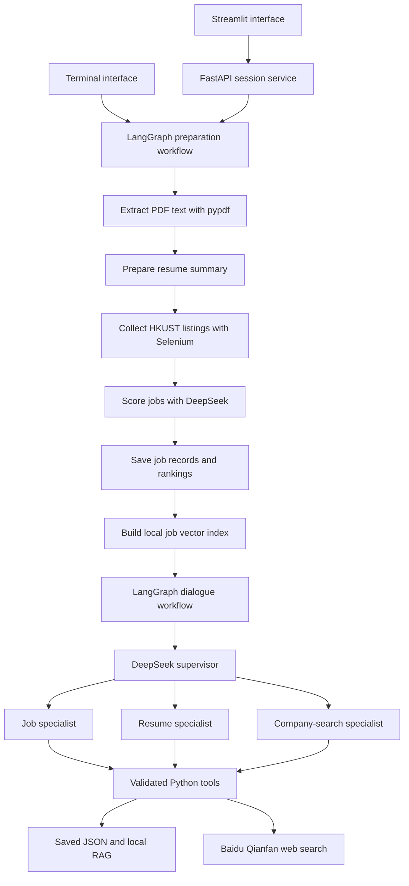

# HKUST Career Assistant

A conversational career assistant that helps students find relevant HKUST Job Board opportunities, understand their fit, and prepare applications.

Upload a searchable PDF resume, choose job filters, and explore personalized rankings through a browser or terminal chat. Follow-up questions such as **“Why do I fit the second one?”** use the most recently displayed job list.

> An independent student-built prototype. It is not an official HKUST service.

## Features

- **Resume-based matching:** extract searchable PDF text, collect filtered listings, and generate scored JSON rankings with DeepSeek.
- **Contextual conversations:** use LangGraph to coordinate a supervisor and job, resume, and company-search specialists across up to 30 user turns.
- **Job discovery with RAG:** search saved job titles and descriptions using Sentence Transformers embeddings, SQLite storage, and NumPy cosine similarity.
- **Application support:** ask about job fit, requirements, truthful resume improvements, and interview preparation.
- **Company and career research:** retrieve live web sources through Baidu Qianfan and return source-linked answers.
- **Two interfaces:** use Streamlit with a local FastAPI backend, or run the terminal application.
- **Session cleanup:** remove generated outputs when a session ends; web sessions also remove their uploaded resume copy.

## Example conversation

```text
You: Show my top 10 jobs.
Assistant: Returns companies, job titles, reference numbers, and saved scores.

You: Why do I fit the second one?
Assistant: Resolves the second job in the displayed list and explains strengths,
           gaps, and missing evidence using the saved job and resume summary.

You: How should I prepare for its interview?
Assistant: Suggests preparation topics grounded in that job's requirements.

You: Tell me about that company.
Assistant: Searches for company information and provides source links.

You: That's all, thanks.
Assistant: Ends the session and clears generated session files.
```

## Architecture



### Preparation

1. Validate the PDF and extract text from each page.
2. Prepare a resume summary of at most **1,000 counted units** for chat. Each Chinese character and each other word counts as one unit.
3. Open Chrome for manual institutional login and declarations.
4. Apply selected filters and collect listings across result pages.
5. Fetch details concurrently inside the authenticated browser, deduplicate records, and exclude expired listings. Listings whose deadlines remain unverified are also excluded.
6. Send the **full extracted resume text** and each job description to DeepSeek for scoring.
7. Save ranked results and build the name and full-job semantic collections.

The active scoring path uses a two-line model response containing a score and recommendation level. Python parses the score and sorts results deterministically. The repository also contains a separate evidence-based scorer; the normal preparation workflow currently uses `legacy_scores()`.

### Conversation and memory

The supervisor proposes up to three specialist tasks. Each specialist chooses from its permitted tool schemas. Python validates arguments and executes tool calls sequentially, allowing later calls to use updated job references.

LangGraph's `InMemorySaver` retains conversation state for the current session. The models receive the latest 12 user/assistant messages and explicit fields such as `displayed_job_ids`, `selected_job_id`, and `selected_company`.

- **“The second one”** means the second item in the most recently displayed list.
- **“It”** refers to the selected job.
- Displaying a new list replaces the previous ordinal references.
- Sessions end after a goodbye or the 30th user turn.
- `recursion_limit=64` limits graph traversal within one invocation; it is not the history length or dialogue-round limit.

The specialist's model → tool → result → next-decision loop provides bounded ReAct-style tool use.

### Retrieval and search

The local RAG index contains two logical collections:

| Collection | Contents | Purpose |
|---|---|---|
| `names` | Company and job title | Resolve mixed or incomplete job names |
| `jobs` | Overlapping chunks of full job records | Retrieve listings by skills or criteria |

Vectors are stored in SQLite and searched with exact cosine similarity in NumPy. For recognized skills such as Python, the criteria tool checks every indexed job and verifies mentions against saved source text. Other criteria may require model classification and can produce uncertain results.

Company and HKUST career-service questions use **live web search**. This version does not include a separate local Career Center document knowledge base.

## Technology stack

| Component | Technology |
|---|---|
| Application | Python |
| Workflow and conversation state | LangGraph, LangChain Core |
| Language model | DeepSeek through the OpenAI-compatible SDK |
| Web interface | Streamlit |
| Local backend | FastAPI, Uvicorn |
| Resume extraction | pypdf |
| Authenticated scraping | Selenium, browser JavaScript, Fetch API |
| Embeddings | Sentence Transformers |
| Vector storage and similarity | SQLite, NumPy |
| Web search | Baidu Qianfan, HTTPX |
| Data validation | Pydantic |
| Configuration | python-dotenv |
| Testing | unittest, mocked external services |

## Installation

You need Python with the dependencies in `requirements.txt`, Google Chrome, access to the HKUST Job Board, and the provider credentials described below.

From the repository root:

```bash
python3 -m pip install -r requirements.txt
```

An isolated environment is optional, but helps avoid dependency conflicts:

```bash
python3 -m venv .venv
source .venv/bin/activate
python -m pip install -r requirements.txt
```

Use the same Python interpreter to install dependencies and launch the application.

Create a `.env` file in the repository root:

```dotenv
DEEPSEEK_API_KEY=your_deepseek_api_key
DEEPSEEK_MODEL=your_available_deepseek_model
QIANFAN_API_KEY=your_qianfan_api_key
```

DeepSeek is required for scoring and model-driven chat. Qianfan is required for company and career-service web search.

Optional settings include `DEEPSEEK_BASE_URL`, `HKUST_JOB_URL`, `EMBEDDING_MODEL`, `FETCH_WORKERS`, `REQUEST_TIMEOUT`, and `FETCH_ATTEMPTS`. The default embedding model is `sentence-transformers/paraphrase-multilingual-MiniLM-L12-v2`; its first use requires a model download.

## Run the browser application

```bash
python3 run_web.py
```

Open [http://127.0.0.1:8501](http://127.0.0.1:8501).

1. Upload a searchable, unencrypted PDF resume: **up to 20 MiB and 20 pages**, with readable text on every page. OCR is not supported.
2. Complete HKUST login and declarations in the Chrome window opened by Selenium.
3. Select filters in the web interface. Options are read from the live Job Board.
4. Wait for collection, scoring, and indexing.
5. Ask about your matches, resume, interviews, or companies.
6. Say goodbye to end the session and remove its uploaded PDF and generated files.

FastAPI runs on `127.0.0.1:8000`; Streamlit runs on `127.0.0.1:8501`. Press **Ctrl+C** in the launch terminal to stop both services. Browser security may prevent automatic tab closure; you can close the tab manually after the session ends.

## Run the terminal application

Place your resume at `data/resume.pdf`, then run:

```bash
python3 main.py
```

Or provide a path:

```bash
python3 main.py --resume "/full/path/to/resume.pdf"
```

To skip all filter selections:

```bash
python3 main.py --resume "/full/path/to/resume.pdf" --filters-json '{}'
```

Each normal launch starts a fresh preparation and scoring run. Use `goodbye`, `/exit`, `/quit`, or Ctrl+C to finish. The original terminal input PDF is preserved during cleanup.

## Tools

| Tool | Responsibility |
|---|---|
| `tool_return_jobs` | Return a 1-based inclusive range from saved rankings |
| `tool_job_resume_question` | Explain fit, requirements, resume changes, or interview preparation for a resolved job |
| `tool_find_required_jobs` | Check saved listings for skills or broader criteria |
| `tool_search` | Search company/career topics and return source-linked information |
| `tool_summarize` | Copy or summarize supplied text; chat calls do not overwrite the prepared resume |
| `bye_tool` | End the conversation and clear generated outputs |

## Repository structure

```text
.
├── main.py                     # Terminal entry point
├── run_web.py                  # Launch both local web services
├── streamlit_app.py             # Upload, filter, and chat screens
├── api.py                      # HTTP endpoints and per-user web sessions
├── config.py                   # Settings, services, and prepared-data validation
├── job_matcher_tool.py          # PDF validation, scraping, scoring, and JSON utilities
├── diagnostics.py              # Sanitized error reporting
├── requirements.txt
├── .streamlit/config.toml       # Streamlit upload configuration
├── agents/                     # Supervisor, specialists, and DeepSeek adapter
├── prompts/                    # Agent instructions
├── workflows/                  # Preparation graph, dialogue graph, and state schemas
├── tools/                      # Tool functions, schemas, and dispatch
├── rag/                        # Documents, embeddings, SQLite store, and retrieval
├── tests/                      # Automated tests and synthetic fixtures
├── reports/                    # Historical implementation and verification reports
└── data/                       # Local inputs, caches, and session outputs; Git-ignored
```

## Generated files and privacy

Terminal runs use `data/`. Web runs use separate directories under `data/web_sessions/`.

| File | Contents |
|---|---|
| `resume.txt` | Resume summary used for dialogue |
| `jobs.json` | Full validated job records |
| `jobs_nodes.json` | Company/title rows for name retrieval |
| `result.json` | Scores, ranks, job references, and original model responses |
| `vector_db/jobs.sqlite` | Local job embeddings and index metadata |
| `prepared.json` | Dataset readiness fingerprint |
| `pending_match.json` | Temporary scoring progress checkpoint |
| `last_error.txt` | Sanitized failure diagnostic, when available |

Conversation checkpoints are kept in memory; the current application does not write a conversation database. Normal session cleanup removes generated outputs. Downloaded embedding weights remain cached. Forced termination can leave local files because cleanup code cannot run.

Resume and job text are sent to DeepSeek for scoring and relevant chat answers. Company-search queries are sent to Qianfan. Local file deletion does not imply deletion of provider-side records.

Keep `.env`, resumes, scraped data, generated outputs, and `.venv` out of Git. The included `.gitignore` excludes these paths. This prototype runs locally and does not implement production authentication or persistent application tracking.

## Testing

```bash
python3 -m unittest discover -s tests -v
```

The tests exercise PDF parsing, scoring contracts, staging, RAG, job references, tool validation, dialogue limits, cleanup, and the web-session flow. External model, browser, and search interactions are mocked where appropriate. Passing these tests does not establish live scraping reliability, model answer quality, or production performance.

Historical reports may describe earlier behavior. Use the current source and this README for the active application design.

## Troubleshooting

| Problem | What to check |
|---|---|
| `ModuleNotFoundError` | Install `requirements.txt` with the same interpreter used to launch the app |
| Resume rejected | Confirm the PDF is unencrypted and contains readable selectable text on every page |
| Summary exceeds 1,000 units | The model ignored the requested length across bounded retries; inspect the summarizer and retry |
| Browser waits at login | Complete institutional login and both declarations in Chrome |
| Scraping fails | Check login state, connectivity, and whether the site's HTML selectors changed |
| Company search fails | Check Qianfan credentials and search-service access |
| Prepared data is stale | Start a fresh run to regenerate scores and the index |
| Web app cannot connect | Start both services with `python3 run_web.py` and check port availability |

## Limitations

- Scores are model assessments of documented fit, not hiring probabilities or verified eligibility decisions.
- Rankings cover the filtered listings collected during that session.
- A skill mention may be preferred or optional; review the quoted listing and original posting.
- Resume summaries can omit information that affects follow-up advice.
- Scraping depends on the external website's HTML and authenticated session.
- Fresh collection and per-job scoring can take time and incur provider API charges.
- This is a local prototype; broader deployment requires additional work on authentication, access control, concurrent workloads, and operational monitoring.

## Author

Fubo Ma
